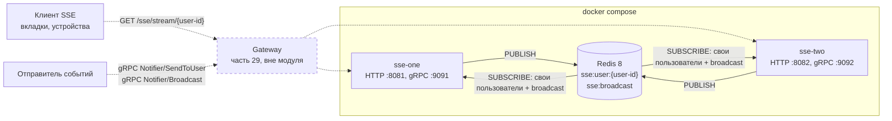
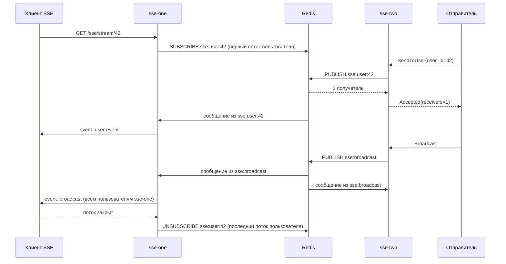
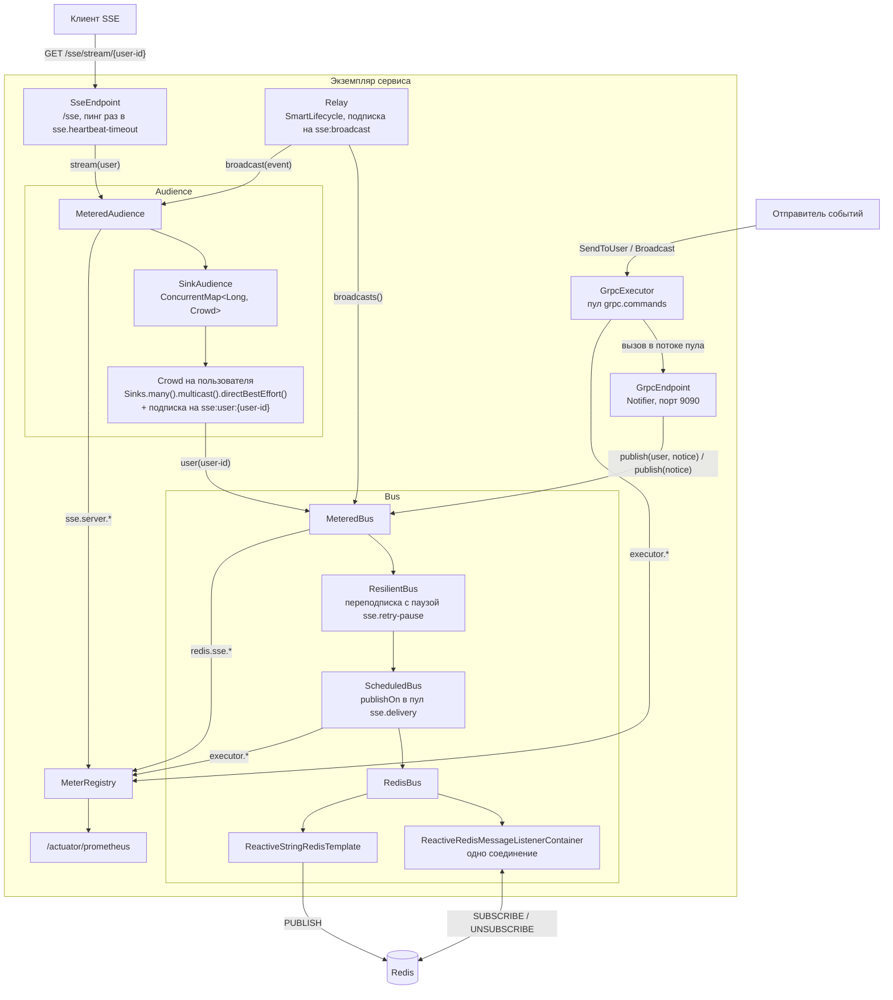

# Часть 30 — схема сервиса

[← к описанию части](README.md)

## Развёртывание

Два экземпляра сервиса из [`docker-compose.yaml`](docker-compose.yaml)
подключены к одному Redis. Любой экземпляр отдаёт потоки по HTTP
и принимает отправку по gRPC. У каждого пользователя свой канал
`sse:user:{user-id}`, на который подписан только тот экземпляр, где у этого
пользователя открыт поток. На общий канал `sse:broadcast` подписаны все
экземпляры с момента запуска.

Gateway в модуле нет, он показан пунктиром. В compose клиенты обращаются
к экземплярам напрямую: HTTP на портах `8081` и `8082`, gRPC на `9091`
и `9092`. В настоящей системе между ними стоит gateway, как в
[части 29](../29-spring-cloud/README.md): он приносит идентификатор пользователя.

## Адресная и широковещательная доставка

Личное уведомление получает только экземпляр с подключённым пользователем.
Общее получают все экземпляры, и каждый рассылает его своим пользователям.

## Компоненты экземпляра

Сборка — в [`SseConfiguration`](src/main/java/ru/sprbut/m30/SseConfiguration.java).
`Audience` и `Bus` обёрнуты декораторами. Все подписки идут через один
`ReactiveRedisMessageListenerContainer`, то есть через одно соединение Redis.
Публикация идёт через `ReactiveStringRedisTemplate`: соединение в режиме
подписки других команд не принимает. Уведомления уходят в канал как JSON
`{"event", "text"}`, а возвращаются как `ParsedNotice`: битое пропускается,
подписку оно не рвёт.

Работа идёт в двух пулах из `sse.pools.*`. `ScheduledBus` переносит события
подписок из потока соединения Redis в пул `sse.delivery`, а сервер gRPC
выполняет вызовы в пуле `grpc.commands`, который отдаёт ему `GrpcExecutor`.
Метрики обоих пулов — `executor.*` с тегом `name`.

