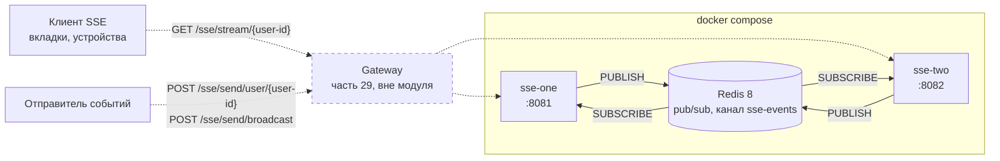
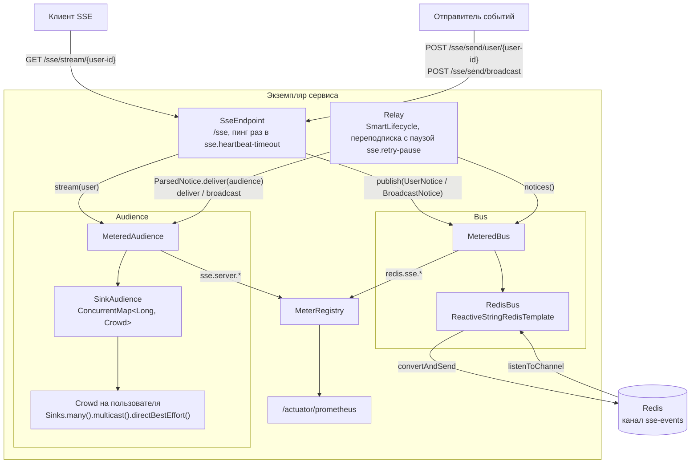

# Часть 30 — схема сервиса

[← к описанию части](README.md)

## Развёртывание

Два экземпляра сервиса из [`docker-compose.yaml`](docker-compose.yaml)
подключены к одному Redis. Любой экземпляр принимает и потоки, и отправку:
отправитель публикует уведомление в канал `sse-events`, а получают его
все экземпляры, включая самого отправителя.

Gateway в модуле нет, он показан пунктиром. В compose клиенты обращаются
к экземплярам напрямую через порты `8081` и `8082`. В настоящей системе
между ними стоит gateway, как в [части 29](../29-spring-cloud/README.md):
он приносит идентификатор пользователя.

## Компоненты экземпляра

Сборка — в [`SseConfiguration`](src/main/java/ru/sprbut/m30/SseConfiguration.java).
`Audience` и `Bus` обёрнуты декораторами метрик. Уведомления `UserNotice`
и `BroadcastNotice` уходят в канал как JSON. Из канала они возвращаются
как `ParsedNotice` и разбираются только в момент доставки.

